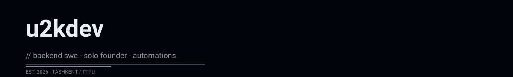

 

  solo founder | building products, APIs, automations

 

## PROJECT SHOWCASE

Selected projects built end-to-end, solo.

### turintime

**Time table platform for TTPU**: PWA (RU/EN, offline) + Telegram bot in one process — live schedule, morning digests, reminders.

**What it does**: Students get live schedules, automatic digests, and reminders — all in one unified process.

**Key technologies**: FastAPI · PWA · Telegram Bot · PostgreSQL · Docker

<a href="https://github.com/u2kdev/turintime" style="color:#EEE; text-decoration:underline;">View on GitHub</a>

---

### edu

**e-darschi**: multi-tenant SaaS LMS for learning centers — schedule, attendance, gradebook, homework, payments, mobile cabinet.

**What it does**: Learning centers manage schedules, attendance, grades, homework, payments — all in one SaaS system.

**Key technologies**: Next.js 14 · TypeScript · Prisma · PostgreSQL

<a href="https://github.com/u2kdev/edu" style="color:#EEE; text-decoration:underline;">View on GitHub</a>

---

### UZDF

**Federation platform**: application + website + server / CRM.

**What it does**: Full-stack platform for drone federation: web app, mobile app, server-side CRM, integrations.

**Key technologies**: Dart · Flutter · Firebase · REST API

<a href="https://github.com/u001us/UZDF" style="color:#EEE; text-decoration:underline;">View on GitHub</a>

---

### uzbook

**Reading app**: a minimal experience for reading and tracking books.

**What it does**: Track reading progress, manage book lists, simple reading journal.

**Key technologies**: TypeScript · React · Node.js · PostgreSQL

<a href="https://github.com/u2kdev/uzbook" style="color:#EEE; text-decoration:underline;">View on GitHub</a>

---

### opencode_limiter

**Limiters / AI workflow automation**: tools for controlling and routing AI agent flows.

**What it does**: Infrastructure for rate-limiting, request routing, and AI agent coordination.

**Key technologies**: Python · FastAPI · Docker · GitHub Actions · PostgreSQL

<a href="https://github.com/u2kdev/opencode_limiter" style="color:#EEE; text-decoration:underline;">View on GitHub</a>

 

## ENGINEERING CATEGORIES

Areas of focus — displayed as categorical focus, not proficiency percentages.

  BACKEND
  API DESIGN
  DOCKER & DEPLOYMENT
  TYPESTACK
  MOBILE
  AI & AUTOMATION

 

## CONTACT

<a href="https://github.com/u2kdev" style="color:#EEE; text-decoration:none;">GitHub</a> ·
<a href="https://t.me/u2kdev" style="color:#EEE; text-decoration:none;">Telegram</a> ·
<a href="mailto:hello@u2k.dev" style="color:#EEE; text-decoration:none;">Email</a>

 

`Always building. Always exploring.` · `© u2kdev`

