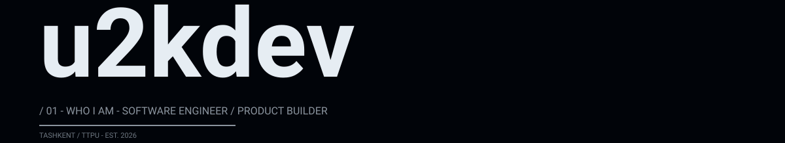

## 01 — WHO I AM

I am a backend engineer building technology products alone — from the first API line to the production database to the shipped interface.

Solo founder mode: I take products end-to-end, without hand-offs.

Previously: student at TTPU; now: software engineer building products, APIs and automation systems.

---

## 02 — PROJECTS

### 01 — [turintime](https://github.com/u2kdev/turintime)

Time table platform for TTPU: PWA (RU/EN, offline) + Telegram bot in one process — live schedule, morning digests, reminders.

**Stack:** FastAPI · PWA · Telegram bot

### 02 — [edu](https://github.com/u2kdev/edu)

e-darschi — multi-tenant SaaS LMS for learning centers: schedule, attendance, gradebook, homework, payments, mobile cabinet.

**Stack:** Next.js 14 · TypeScript · Prisma · PostgreSQL

### 03 — [UZDF](https://github.com/u001us/UZDF)

Federation platform: application + website + server / CRM.

**Stack:** Dart · Flutter

### 04 — [uzbook](https://github.com/u2kdev/uzbook)

Reading app.

### 05 — [opencode_limiter](https://github.com/u2kdev/opencode_limiter)

Limiters / AI workflow automation.

---

## 03 — ENGINEERING

**BACKEND** — Python · FastAPI · Django · PostgreSQL · Prisma · Redis

**FRONTEND** — TypeScript · Next.js · React

**MOBILE** — Dart · Flutter

**INFRA** — Docker · Nginx · GitHub Actions · PostgreSQL

---

## 04 — CONTACT

[GitHub](https://github.com/u2kdev) · [Telegram](https://t.me/u2kdev) · [Email](mailto:hello@u2k.dev)

Always building. Always exploring.

---

`© u2kdev`
